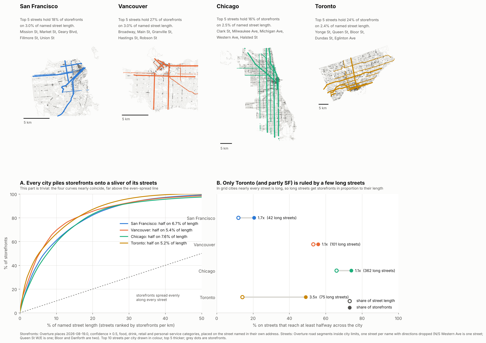

# Street dominance

Are a city's storefronts concentrated on a few long, named streets (Mission, Geary
and Van Ness in San Francisco), or spread across many? And is that unusual, or does
every city look like that? A four-city comparison: San Francisco, Vancouver, Chicago
and Toronto, on Overture Maps data (release 2026-08-19.0).



## Findings so far

- **The trivial part holds everywhere.** Half of storefronts sit on 5 to 8% of
  named street length in all four cities; against a null of storefronts spread
  evenly along streets, the concentration curves nearly coincide.
- **The interesting part is about long streets.** Streets that reach at least
  halfway across the city carry 3.5 times their length share of storefronts in
  Toronto, 1.7 times in San Francisco, and about 1.1 in Chicago and Vancouver,
  where the grid makes nearly every street long. San Francisco is not unique;
  Toronto fits the picture better.
- **Not Zipf.** Storefronts per street are heavy-tailed but lognormal: a power law
  loses to a lognormal in every city (p ≤ 0.005), with a flat head and a
  steepening tail ([rank-size figure](figures/street-rank-size.png)).

Full write-up, choices and caveats: [notes/2026-10-08-street-dominance.md](notes/2026-10-08-street-dominance.md).

## Reproduce

```
pip install -r requirements.txt
for c in sf vancouver chicago toronto; do
  for t in place segment division_area; do python3 src/fetch_overture.py --city $c --type $t; done
done
python3 src/street_dominance.py        # results/street-dominance.json
python3 src/street_rank_size.py        # results/street-rank-size.json
python3 src/plot_street_dominance.py   # figures/street-dominance.png
python3 src/plot_rank_size.py          # figures/street-rank-size.png
```

Extracts are read straight from the public Overture S3 bucket and are not committed;
`data/<city>/*.manifest.json` pins each one (release, bbox, row count, sha256).
The San Francisco places extract refetched on 2026-10-08 had the manifest's row
count but a different checksum; the other eleven matched.

Origin: a side thread of [toponymic-regionalization](https://github.com/dshkol/toponymic-regionalization).
